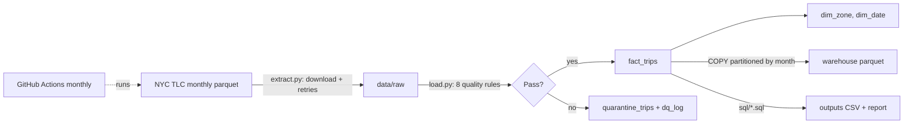

# Trip Data Pipeline

An end-to-end batch data pipeline on public NYC taxi trip records: it downloads monthly trip files,
runs data-quality checks (failed rows are quarantined, never silently dropped), loads clean trips into a
DuckDB star schema, exports month-partitioned parquet, runs SQL analytics, and runs on a monthly schedule
with GitHub Actions.

**Report:** [reports/pipeline_report.md](reports/pipeline_report.md)



## Key results
- Processed 5.97M NYC taxi trips (Jan-Feb 2024) in about 35 seconds: 5.77M loaded, 205,732 (3.44%) quarantined across 8 quality rules.
- Biggest quality issues: zero-distance trips (2.0-2.3%) and negative amounts (1.3%); no missing required fields.
- Weekday demand peaks at 18:00; average speed drops from 22.7 mph at 04:00 to about 11 mph across 08:00-18:00.
- Manhattan accounts for 90% of trips; Queens trips average 12.7 miles and $52.71, consistent with airport traffic.

## Pipeline
1. **Extract** (`src/extract.py`): downloads each month's trip file and the zone lookup from NYC TLC.
   Idempotent (existing files are skipped) with retries; downloads go to a temporary file first.
2. **Data quality** (`src/load.py`): every row is checked against 8 rules: missing required fields,
   pickup outside the file's month, pickup after drop-off, trips over 6 hours, zero distance,
   negative amounts, average speed over 100 mph, and unknown zones. Failure counts per rule go to `dq_log`;
   failed rows go to `quarantine_trips` with their reason.
3. **Transform and load** (`src/load.py`): clean rows go into `fact_trips`, with `dim_zone` and `dim_date`
   dimensions. Each month is deleted and reloaded inside one transaction, so re-runs never duplicate data
   and a failed run leaves the previous load intact. The fact table is also exported as parquet partitioned by month.
4. **Analytics** (`sql/*.sql`, `src/analytics.py`): demand by hour (weekday vs weekend), top 3 pickup zones
   per day (`ROW_NUMBER`), daily trips with a 7-day moving average (`AVG ... OVER`, `LAG`), fare/time/tip by
   borough, weekday congestion by hour (`RANK`), month-over-month change, and a data-quality summary.
   Results go to `outputs/*.csv` and `reports/pipeline_report.md`.
5. **Orchestration** (`.github/workflows/pipeline.yml`): monthly schedule plus manual runs; runs the tests,
   then the pipeline, and commits refreshed outputs.

## Data model
```
fact_trips (one row per clean trip, by pickup_month)
  pickup_ts, dropoff_ts, pickup_date -> dim_date, pickup_hour,
  pu_zone_id, do_zone_id -> dim_zone, passenger_count, trip_distance,
  duration_min, fare_amount, tip_amount, total_amount, payment_type
dim_zone (zone_id, borough, zone, service_zone)
dim_date (date_key, year, month, day, day_of_week, day_name, is_weekend)
quarantine_trips (source_month, reason, raw fields)
dq_log (run_at, month, rule, failed_rows, total_rows, pct_failed)
load_log (run_at, month, rows_in, rows_loaded, rows_quarantined)
```

## Run it yourself
```bash
python3.11 -m venv .venv
source .venv/bin/activate
pip install -r requirements.txt
pytest -q                 # tests for the quality rules and idempotent loading
python3 run_pipeline.py   # extract -> quality checks + load -> analytics + report
```
Months are set in `src/config.py`.

## Data
NYC Taxi & Limousine Commission (TLC) yellow taxi trip records (public). Raw files and the DuckDB
database are not committed; the analytics outputs and report are.